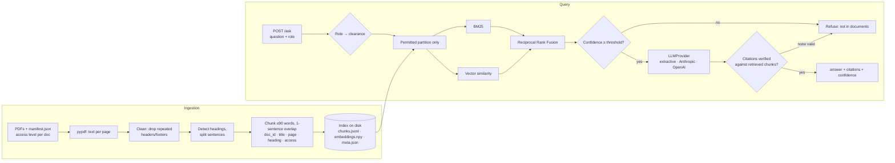

# DocAnswer: an internal knowledge assistant with verified citations

Every week, employees at a mid-size company ask HR and operations the same questions: *What is the hotel cap in Bogota? How many remote days do I get? When must I file my expense report?* The answers are in PDF policies that nobody reads. **DocAnswer** answers from the company's own documents. Every answer cites the document and page, the assistant says *"I can't find this in the documents"* rather than guess, and each user only sees documents their role is cleared for.

> **This is a portfolio demo, not a client project.** The corpus is six synthetic PDFs for a fictional company ("Kestrel Ridge Logistics"). Every number below comes from `make eval` / `make test` on that corpus.

## What it does

- **Ingests PDFs** (`pypdf`) page by page. It strips repeated headers and footers, detects section headings and splits text into sentence-aligned chunks with overlap. A chunk never crosses a page boundary, so every chunk has exactly one page to cite.
- **Uses hybrid retrieval.** BM25 and a vector retriever are merged with Reciprocal Rank Fusion. The vector side sits behind an `Embedder` protocol: TF-IDF character n-grams work offline, and an OpenAI embedder can be switched on.
- **Enforces access control before ranking.** Each clearance level (`public < employees < managers`) has its own BM25 index, built only from the chunks that level may read.
- **Answers through an `LLMProvider` protocol.** The offline `ExtractiveProvider` (the default) quotes the best sentences. The `AnthropicProvider` and `OpenAIProvider` generate answers with a grounded prompt.
- **Verifies citations.** Every `[Doc p.N]` tag must point to a passage that was actually retrieved. Fabricated tags are removed, and an answer with no verifiable citation is replaced by a refusal.
- **Has a refusal gate.** If retrieval confidence is below a threshold (calibrated on a separate dev set), the model is never called.
- **Serves a FastAPI app and a UI.** `POST /ask`, `POST /ingest`, `GET /health`, and a single-page UI at `/` with a role selector and citation cards.

## Architecture



```
src/docanswer/
  ingest.py      PDF → pages → cleaned sections → chunks → Index (save/load)
  embeddings.py  Embedder protocol, TfidfEmbedder (offline), OpenAIEmbedder (opt-in)
  retrieval.py   per-clearance partitions, BM25 + vectors, RRF, confidence
  llm.py         prompt template, LLMProvider protocol, Extractive/Anthropic/OpenAI
  pipeline.py    refusal gate, citation verification, Answer assembly
  api.py         FastAPI app factory; static/index.html is the UI
  eval.py        metrics, ablation by retriever, threshold calibration
scripts/make_corpus.py   reproducible synthetic PDFs (reportlab)
eval/                    questions.jsonl (test), dev_questions.jsonl (calibration), results
```

## Design decisions

1. **Hybrid retrieval.** Policy questions mix exact tokens ("COP 350,000", "L3", "PeopleHub") with paraphrases. BM25 nails the exact tokens and vectors catch the paraphrases. RRF merges the two by rank, so their scores don't need calibrating against each other. The `Embedder` protocol lets a hosted multilingual model replace TF-IDF without touching retrieval code.
2. **Citations are verified, not trusted.** The prompt requires a tag after every factual sentence, using the exact tags shown in the context. After generation, each tag is checked against the retrieved set. Invalid tags are removed, and if no valid citation remains the user gets a refusal instead of an unsupported answer.
3. **Refusal threshold.** Confidence is the IDF-weighted share of the question's terms found in the best of the top-3 chunks. Terms the permitted corpus has never seen ("stock options", "gym") weigh the most, so out-of-scope questions score low. Below the threshold the LLM is not called at all, which is cheaper and leaves nothing to hallucinate from. The threshold (0.47) is the midpoint of the optimal band on `eval/dev_questions.jsonl`, a set kept separate from the test questions (`make calibrate`).
4. **Access control before retrieval, not after.** Filtering results after ranking can still leak through scores, snippets or term statistics. Here each clearance level searches a partition built only from what it may read. Unknown roles fail closed to `public`. A test uses every restricted chunk's own text as the query, for every role and retriever mode, and asserts that nothing leaks.
5. **Evaluation first.** The repo ships with a labelled question set (EN + ES, unanswerable, access-restricted, cross-lingual) and an ablation across `bm25 / dense / hybrid`. Changes are judged by numbers, not by trying a few questions by hand.
6. **Offline by default.** The LLM and embedding providers are opt-in via env vars, and SDKs are imported lazily. Tests inject fake clients, so CI never makes a network call.

## Run it

**Offline, one command** (no API keys; Python ≥ 3.11):

```bash
python -m venv .venv && . .venv/bin/activate
make demo          # install → corpus → ingest → eval → serve on http://localhost:8000
```

Or step by step: `make install corpus ingest eval test run`. With Docker: `docker compose up --build`.

```bash
curl -s localhost:8000/ask -H 'content-type: application/json' \
  -d '{"question": "What is the nightly hotel limit in Bogota?", "role": "employee"}'
# {"answer":"In Colombia the cap is COP 350,000 per night in Bogota and Medellin ... [Travel Policy p.2] ...",
#  "citations":[{"doc":"Travel & Expense Policy","page":2,"snippet":"..."}],"confidence":0.75,"refused":false}
```

**With a real LLM** (I did not run this path in this environment; its code is covered by tests with a fake client):

```bash
pip install -e ".[llm]"
export LLM_PROVIDER=anthropic ANTHROPIC_API_KEY=... LLM_MODEL=claude-sonnet-4-5   # or LLM_PROVIDER=openai
export EMBEDDER=openai OPENAI_API_KEY=...   # optional; re-run `make ingest` after changing the embedder
make run
```

See `.env.example` for all settings. `make eval` always forces the offline extractive stack, so its numbers can be reproduced.

## Evaluation results

**Offline extractive mode on the synthetic corpus**: 6 PDFs, 20 pages, 47 chunks, top-k 5, refusal threshold 0.47. The test set has 34 questions: 25 with a known source page (23 answerable plus 2 Spanish questions about English documents), 5 that the corpus cannot answer, and 4 compensation questions asked by an `employee` that only `manager` may see. Raw output is in `eval/results.json` and `eval/results.md`.

| metric (hybrid retriever) | value |
|---|---|
| Retrieval hit@1 (expected doc + page ranked first) | **0.96** (24/25) |
| Retrieval hit@3 | **1.00** (25/25) |
| MRR@5 | **0.98** |
| Answered and cited the expected page | **0.84** (21/25) |
| False refusals on answerable questions | 0.16 (4/25) |
| Refusal accuracy on unanswerable questions | **0.80** (4/5) |
| Refusal accuracy on access-restricted questions | **1.00** (4/4) |
| Access-control leaks (restricted chunks in any result) | **0** |

**Tests:** `36 passed` (pytest). **Lint:** `ruff check` and `ruff format --check` both clean.

**Reading these numbers honestly**

- **Retrieval has hit the ceiling on this corpus.** BM25, vector-only and hybrid produce identical metrics on 47 chunks (see `eval/results.md`). The ablation is there so differences show up once the corpus grows. It does not show that hybrid is better here.
- **The failures are instructive.**
  - Two answerable questions were refused because the wording doesn't overlap: "minimum password **length**" against "at least 14 **characters**", and "December" against "between 15 November and 10 January".
  - Both cross-lingual questions were refused: lexical confidence cannot match Spanish questions to English text.
  - One out-of-scope question ("Can I bring my dog to the office?") was answered with unrelated onboarding sentences, because "bring" and "office" match.
  - A multilingual embedding model plus an LLM judge of answerability is the production fix. The extractive provider is a safe baseline, not the target.
- **I iterated once and saw the test results before doing so.** First run (simple plural stripping, a threshold of 0.30 picked before looking at any data, sentence scoring that ignored headings): hit@1 0.96, hit@3 1.00, correct-citation 0.84, false refusals 0.12, unanswerable refusal **0.60**. I then made three generic changes:
  - Snowball stemming, which fixed "bonus" being stemmed to "bonu".
  - Section headings counted when scoring sentences.
  - The threshold calibrated on the separate dev set.

  None of these changes is specific to a question. Even so, the test set is no longer strictly blind, and 34 questions is a small sample.

## Limitations and what production would add

- Role comes from the request body for the demo. In production it comes from SSO/JWT claims, and document ACLs are synced from the source system (SharePoint/Drive), not from a manifest file.
- The TF-IDF vectorizer's vocabulary is fitted on the whole corpus. Restricted *content* is never searchable by a lower role, but a strict deployment would fit one vectorizer per partition or use a corpus-independent embedder.
- PDF parsing assumes text-layer PDFs with numbered headings. Scanned documents would need OCR, and tables would need layout-aware parsing.
- No conversation memory, no reranker, no incremental re-indexing. Monitoring of refusals and of 👍/👎 feedback would drive the next evaluation round.

## Resumen en español

**DocAnswer** es un asistente interno que responde preguntas de empleados (RR. HH., viajes, vacaciones, seguridad TI) usando solo los documentos de la empresa:

- Cita documento y página en cada respuesta.
- Responde *"No encuentro esta información en los documentos"* cuando la respuesta no está en las fuentes.
- Aplica permisos por rol **antes** de buscar: cada nivel de acceso tiene su propio índice.

La recuperación es híbrida (BM25 + vectores, fusionados con RRF). Las citas se verifican contra los fragmentos recuperados. El umbral de rechazo se calibra con un conjunto de preguntas separado del de prueba.

Funciona 100 % sin conexión (`make demo`) y admite Anthropic u OpenAI con una variable de entorno. En el corpus sintético (empresa ficticia, demo de portafolio, no un proyecto de cliente):

- hit@3 = 1,00
- 84 % de respuestas citan la página correcta
- 80 % de rechazo correcto en preguntas sin respuesta
- 0 fugas de control de acceso
- 36 pruebas automatizadas
